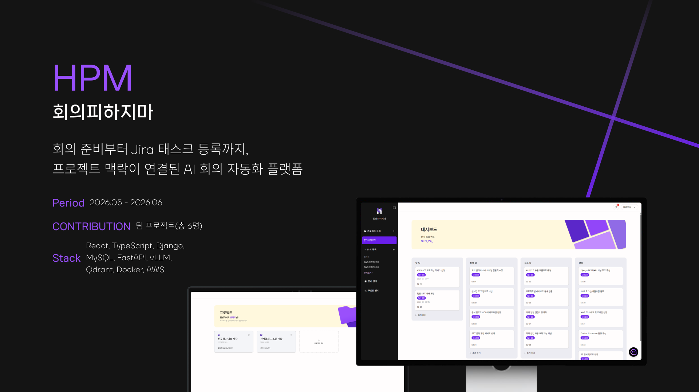

<p align="center">
  
</p>

# 회의피하지마 HPM

> AI 기반 통합 회의 관리 플랫폼  
> 회의 준비부터 회의 진행, 회의록 생성, 태스크 추출, Jira 연동까지 하나의 흐름으로 연결하는 **회의 자동화 협업 서비스**

---

## 📑 목차
1. [주요 역할](#-주요-역할)
2. [기술 스택](#-기술-스택)
3. [산출물](#-산출물)
4. [개요](#-개요)
5. [주요 기능](#-주요-기능)
6. [서비스 흐름](#-서비스-흐름)
7. [시스템 아키텍처](#-시스템-아키텍처)
8. [ERD](#-erd)
9. [활용 데이터](#-활용-데이터)
10. [모델 선정](#-모델-선정)
11. [파일 구성](#-파일-구성)
12. [기대 효과](#-기대-효과)
---

## 👥주요 역할
### 🐸 류지우(외 5명)
- 회의 자료 업로드(OCR) 기반 기초 안건 생성 및 준비 자료 생성 기능 백엔드/프론트엔드 구현
- 회의 녹음(STT), AI 회의록 생성 백엔드/프론트엔드 구현
- 프로젝트 문서 기반 AI 질의응답 챗봇 백엔드/프론트엔드 구현
- 회의록 생성 프롬프트 작성
- sLLM 비교 테스트
- 로그인 기능 백엔드/프론트엔드 구현
- DB 설계
- 프로젝트 기획 및 UI/UX 설계

---

## 🔧 기술 스택

| 영역 | 사용 기술 |
| --- | --- |
| Frontend | React, TypeScript, Vite, Zustand, Axios, Tailwind CSS |
| Backend | Django, Django REST Framework, Simple JWT, MySQL |
| AI | FastAPI, WhisperX, PaddleOCR-VL, vLLM, Qdrant, SentenceTransformers |
| Infra | Docker, nginx, RunPod, AWS S3/SES, Jira API |
| Collaboration | GitHub, Jira, Postman, VSCode |

---
## 📋 산출물
- [기획서](document/프로젝트%20기획서.pdf)
- [요구사항 정의서](document/요구사항%20정의서.pdf)
---

## 🔍 개요

### 배경

2020년 이후 국내 협업 SW 시장은 지속적으로 확장 중이다.<br> 금융권까지 STT + LLM 기반 AI 회의록을 도입하고 있다. AI 회의 어시스턴트 시장은 빠르게 성장하고 있다.

### 문제

회의 전 : 목적 / 안건이 정리되지 않은 채 시작<br>
회의 후 : 결과가 업무로 이어지지 않음<br>
기존 AI 회의 도구는 전사 / 요약 등 일부 기능에만 집중<br>
협업, 프로젝트 관리, AI 도구 분산 → 툴 피로, 실무 반영 지연

### 해결

회의 준비부터 업무 배정까지 하나의 플랫폼으로 연결<br>
회의 결과를 담당자/기한/우선순위가 있는 태스크로 전환

### 타겟층

회의 전후의 단절로 비효율을 겪는 조직과 실무자


## 📍 주요 기능
### AI 기반 회의록 및 태스크 자동화
- 회의 녹음(STT)을 기반으로 회의록 및 태스크 자동 추출
- 추출된 태스크를 Jira에 자동 등록
### 프로젝트 지식 기반 AI 질의응답
- 플로팅 챗봇을 통한 프로젝트 문서 및 관련 내용 질의응답 가능
- 문서 기반 출처 표기 답변 제공
### 회의 사전 준비
- 회의 관련 자료 업로드 및 관리
- 업로드된 자료를 기반으로 기초 안건 생성
### Jira 연동
- Jira 계정 연동을 통한 프로젝트 생성 및 구성원 추가 가능
- Jira 태스크 조회 및 대시보드 기반 관리
### 회의 결과 공유
- 생성된 회의록을 참여자에게 이메일로 발송
### 실시간 알림
- 프로젝트, 회의, 자료 업로드 등 주요 이벤트에 대한 실시간 알림 제공
<br>

## 🌊 서비스 흐름

```mermaid
flowchart LR
    A["회의 생성"] --> B["AI 기초 안건 생성"]
    B --> C["회의 준비 자료 생성"]
    C --> D["회의 시작 및 진행<br/>RAG 챗봇 동시 사용 가능"]
    D --> E["회의 종료"]
    E --> F["STT 변환 및 화자 분리<br/>자동 수행"]
    F --> G["발화자 매핑<br/>SPEAKER_00 → 참여자 실명 수동 연결"]
    G --> H["회의록 생성 및 태스크 자동 추출<br/>회의록 생성 API에서 동시에 처리"]
    H --> I["회의록 승인 처리"]
    I --> J["요약 이메일 발송<br/>AWS SES 기반 회의록·태스크 발송"]
    J --> K["Jira 태스크 등록<br/>확정된 태스크를<br/>Jira 이슈로 생성"]
    K --> L["칸반 대시보드<br/>Jira 이슈 상태 기반 태스크 관리"]
```


---

## 🧾 시스템 아키텍처


회의피하지마는 React 기반 프론트엔드, Django REST Framework 기반 백엔드, FastAPI 기반 AI 서버, MySQL 데이터베이스, Qdrant 벡터 데이터베이스, Jira API 연동 구조로 구성된다.

주요 AI 기능은 OCR, STT, 문서 파싱·임베딩, LLM/RAG 서버로 분리하여 관리한다. 백엔드는 회의·프로젝트·사용자·문서·태스크 데이터를 관리하고, AI 서버와 통신하여 안건 생성, 준비 자료 생성, 회의록 생성, 태스크 추출 결과를 저장한다.

---

## 📄 ERD


---

## 📊 활용 데이터

| 데이터 | 활용 방식 |
| --- | --- |
| 회의 기본 정보 | 회의 주제, 장소, 일정, 참여자를 기반으로 회의 생성 및 안내 메일 발송에 활용 |
| 외부 요청 자료 | JPG, JPEG, PNG, PDF 형태의 자료를 OCR 처리하여 기초 안건과 준비 자료 생성에 활용 |
| 내부 문서 | 프로젝트별 문서를 RAG 검색 대상으로 사용하여 준비 자료와 챗봇 답변의 근거로 활용 |
| 이전 회의록 | 과거 회의 맥락을 검색하여 회의 준비 자료 생성 및 회의 중 챗봇 답변에 활용 |
| 회의 녹음 파일 | STT 변환, 화자 분리, 회의록 생성, 태스크 추출의 입력 데이터로 활용 |
| 태스크 데이터 | 회의 후 도출된 업무를 칸반 대시보드와 Jira 이슈로 연동 |
| 챗봇 질의/답변 내역 | 회의 중 사용자의 질문과 답변을 저장하여 회의 종료 후 조회 가능하도록 활용 |

---

## 🤖 모델 선정

| 영역 | 선정 방향 | 활용 목적 | 모델명 |
| --- | --- | --- | --- |
| OCR | 문서·이미지 텍스트 추출 모델 | 외부 요청 자료와 스캔 문서의 텍스트 변환 | PaddleOCR-VL |
| STT | WhisperX 기반 음성 인식 | 회의 녹음 파일을 텍스트로 변환 | WhisperX (large-v3) |
| Embedding | 한국어 문맥을 반영한 임베딩 모델 | 내부 문서, 이전 회의록, 프로젝트 자료 검색 | ko-sroberta-multitask |
| 문서 파싱 | 다양한 형태의 문서 대응에 적합한 마크다운 청킹 방식 모델 | 내부 문서를 청킹하여 RAG로 활용 | MinerU |
| LLM | vLLM 기반 회의 요약·생성 모델 | 기초 안건 생성, 준비 자료 생성, 회의록 생성, 태스크 추출 | Gemma3-12B |

모델은 단순히 성능만 기준으로 선정하지 않고, 한국어 회의 데이터 처리 품질, 처리 속도, 비용, 배포 가능성, 회의록·태스크 생성 결과의 안정성을 함께 고려한다.

---

## 🗂️ 파일 구성

```text
SKN24-FINAL-1Team/
├─ frontend/          React + TypeScript + Vite
├─ backend/           Django REST Framework API
├─ ai/
│  ├─ ocr/            OCR server
│  ├─ stt/            WhisperX STT server
│  ├─ parsed/         Document parsing + embedding + Qdrant ingest
│  └─ vllm/           LLM/RAG server
├─ docker-compose.yml
├─ Dockerfile.backend
├─ Dockerfile.frontend
└─ nginx.conf
```

---

## 🌟 기대 효과

- 회의 전 안건과 준비 자료를 자동 생성하여 **회의 준비 시간을 줄인다.**
- 회의 중 필요한 정보를 즉시 검색할 수 있어 **회의 흐름과 의사결정 속도를 개선한다.**
- 회의 후 회의록과 태스크를 자동 생성하여 **수작업 정리 부담을 줄인다.**
- 담당자, 기한, 우선순위가 포함된 태스크를 Jira와 연동하여 **회의 결과의 실행력을 높인다.**
- 여러 협업 도구를 오가는 과정을 줄여 **툴 피로와 컨텍스트 전환 비용을 완화한다.**

---